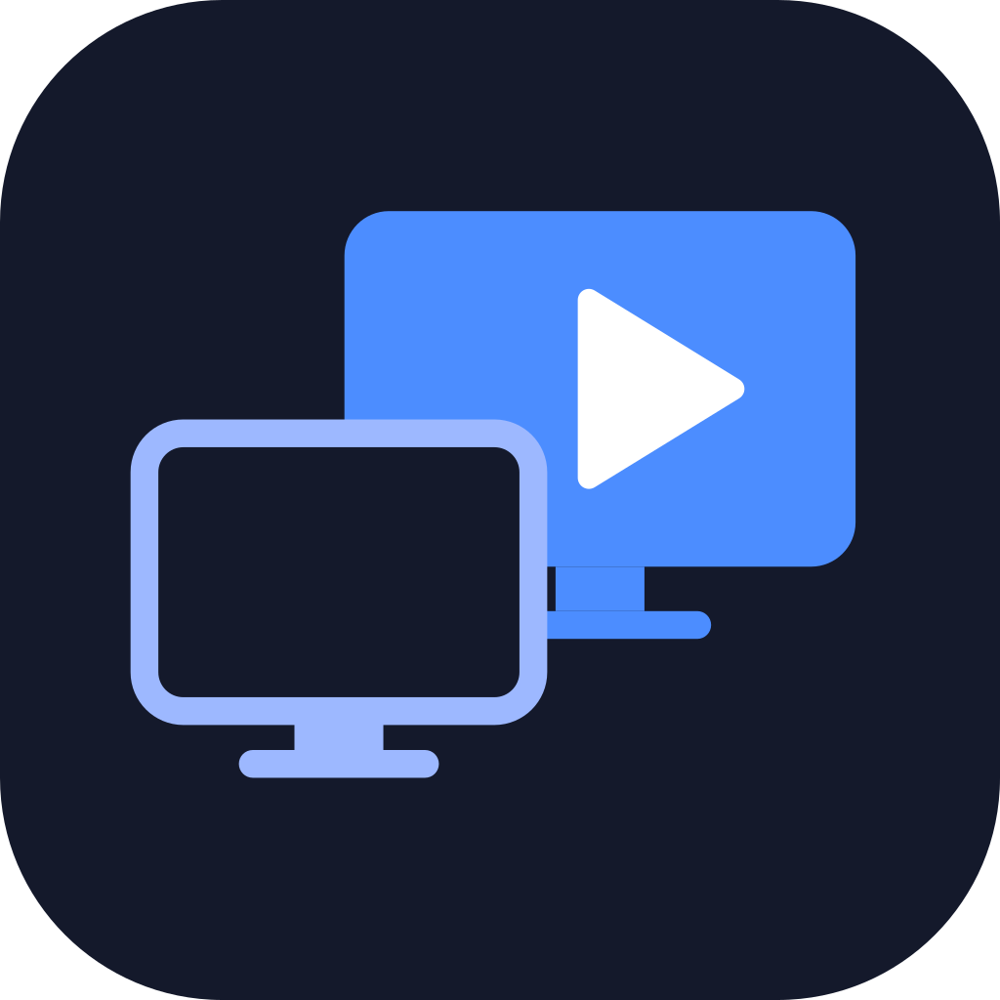

<p align="center"></p>

# App Player YouTube

Toca vídeo/playlist do YouTube em um monitor secundário, controlado por uma janela na tela principal.

## Baixar

[](https://github.com/thiagovallory/app-player-youtube/releases/latest)

Clique no arquivo do seu sistema (sempre a versão mais recente). Todas as versões ficam em [Releases](https://github.com/thiagovallory/app-player-youtube/releases).

| Sistema | Como usar | Download |
|---|---|---|
| macOS (Apple Silicon: M1, M2, M3…) | Executar (descompacte o `.zip`) | [Player-YouTube-mac-arm64.zip](https://github.com/thiagovallory/app-player-youtube/releases/latest/download/Player-YouTube-mac-arm64.zip) |
| macOS (Intel) | Executar (descompacte o `.zip`) | [Player-YouTube-mac-x64.zip](https://github.com/thiagovallory/app-player-youtube/releases/latest/download/Player-YouTube-mac-x64.zip) |
| Windows 10/11 (64 bits) | Instalar | [Player-YouTube-win-x64-setup.exe](https://github.com/thiagovallory/app-player-youtube/releases/latest/download/Player-YouTube-win-x64-setup.exe) |
| Windows 10/11 (64 bits) | Executar, sem instalar | [Player-YouTube-win-x64-portable.exe](https://github.com/thiagovallory/app-player-youtube/releases/latest/download/Player-YouTube-win-x64-portable.exe) |
| Windows 10/11 (ARM) | Instalar | [Player-YouTube-win-arm64-setup.exe](https://github.com/thiagovallory/app-player-youtube/releases/latest/download/Player-YouTube-win-arm64-setup.exe) |
| Windows 7 / 8 / 8.1 (64 bits) | Instalar (versão "legado") | [Player-YouTube-win7-x64-setup.exe](https://github.com/thiagovallory/app-player-youtube/releases/latest/download/Player-YouTube-win7-x64-setup.exe) |
| Windows 7 / 8 / 8.1 (32 bits) | Instalar (versão "legado") | [Player-YouTube-win7-ia32-setup.exe](https://github.com/thiagovallory/app-player-youtube/releases/latest/download/Player-YouTube-win7-ia32-setup.exe) |

Os apps não têm assinatura paga, então na primeira abertura o macOS e o Windows mostram um aviso de segurança: veja [Gerar executáveis](#gerar-executáveis) para saber como liberar. As versões "legado" usam o Electron 22 (sem correções de segurança): use-as só em Windows que não rodam as versões normais.

## Rodar

```bash
npm install
npm run dev        # desenvolvimento
npm run build && npm run preview   # build de produção local
npm test           # testes unitários
```

## Uso

1. Cole o link de um vídeo ou playlist e clique em **Adicionar à fila** (ou Enter). Adicionar não toca sozinho: se a fila estava vazia, o primeiro item fica apenas selecionado. Para tocar, use **Tocar agora** (substitui a fila inteira pelo link e toca), o botão ▶ ou clique no título de um item da fila. Se o vídeo já estiver na fila, o app pede confirmação antes de adicionar de novo.
2. Playlists entram com todos os vídeos (até 200); os títulos aparecem aos poucos.
3. Na fila: arraste para reordenar, ✕ remove, clique no título para tocar aquele item, **Limpar** esvazia.
4. O menu **☰** (canto superior esquerdo) reúne três blocos:
   - **Monitor**: escolha o monitor de reprodução (**Identificar** mostra o número em cada tela).
   - **Salvar fila**: guarda a fila atual com um nome.
   - **Filas salvas**: **Adicionar** acrescenta os itens ao fim da fila atual (sem tocar), **Substituir** troca a fila atual, seleciona o primeiro item e para o player (sem tocar) e **Excluir** apaga a fila salva. A fila ativa não é restaurada ao abrir o app.
5. Use play/pause, anterior/próximo, seek e volume. **Parar** fecha o player e mantém a fila.

## Gerar executáveis

Os arquivos saem em `dist/` (fora do git).

```bash
npm run dist:mac   # macOS: .zip com o Player YouTube.app (arm64 e x64)
npm run dist:win   # Windows 10/11: instaladores x64 e arm64 + .exe portátil x64
npm run dist:win-legacy   # Windows 7/8/8.1 (e 10/11 de 32 bits): instaladores x64 e 32 bits (Electron 22)
```

- **macOS:** descompacte o `.zip` e execute o app, sem instalar. Ele não é assinado com certificado de desenvolvedor (só assinatura ad-hoc), então na primeira vez o macOS bloqueia: clique com o botão direito no app > Abrir > Abrir, ou libere em Ajustes do Sistema > Privacidade e Segurança. Se aparecer "danificado", rode `xattr -dr com.apple.quarantine "Player YouTube.app"`.
- **Windows (Windows 10 ou 11):**
  - `...-win-x64-setup.exe`: instalador para PCs comuns (64 bits). Instala só para o usuário, sem pedir administrador, e cria atalhos e desinstalador.
  - `...-win-arm64-setup.exe`: instalador para Windows no ARM.
  - `...-win-x64-portable.exe`: roda direto, sem instalar (abre mais devagar, pois se descompacta a cada abertura).
  - O SmartScreen mostra "O Windows protegeu seu PC": clique em "Mais informações" > "Executar assim mesmo".
  - Windows de 32 bits não é suportado por esta versão (o Electron 44 não publica essa versão).
- **Windows 7, 8, 8.1 e Windows de 32 bits (versão "legado"):** `...-win7-x64-setup.exe` e `...-win7-ia32-setup.exe` (Electron 22, o último com esse suporte). Eles também funcionam no Windows 10/11, mas use os instaladores normais lá. Limitações: o Electron 22 não recebe mais correções de segurança e o Chromium dele é antigo, então o YouTube pode deixar de funcionar nele a qualquer momento. No Windows 7 instale antes as atualizações do sistema (SP1 e as de segurança). Esses instaladores foram verificados no Electron 22 (macOS) e não em um Windows 7/8 real.
- Sem certificado pago não há assinatura nem notarização; o app funciona igual depois dos avisos da primeira abertura. O build do Windows também pode ser gerado neste Mac.

## Limitações

- Anúncios do YouTube aparecem (limite da IFrame API).
- Alguns vídeos bloqueiam reprodução embutida; o app avisa e, em playlist, pula para o próximo.

## Licença

Uso **não comercial**: você pode usar, copiar e modificar o app livremente, mas **não pode vender**. Licença [PolyForm Noncommercial 1.0.0](LICENSE) (o código é público, mas não é "open source" no sentido da OSI).
